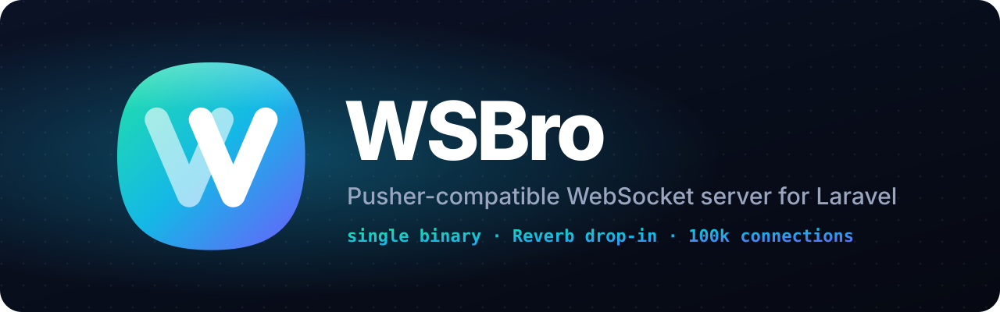
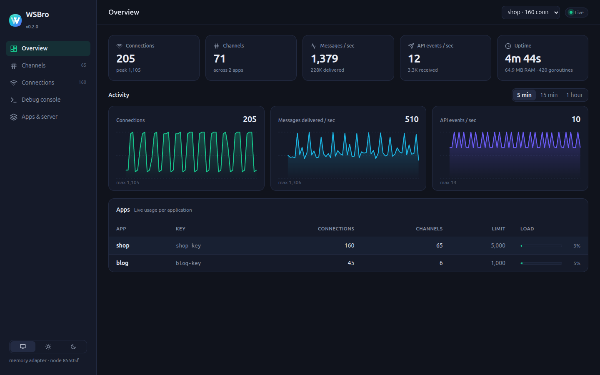
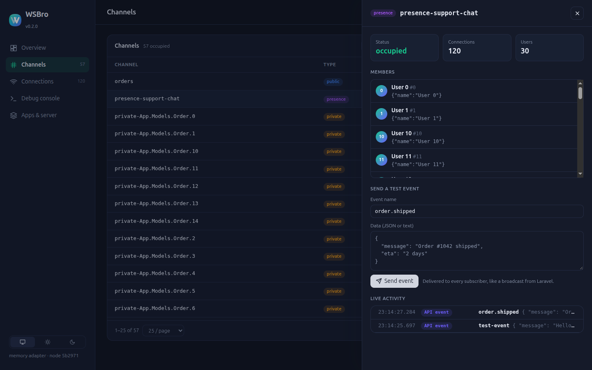
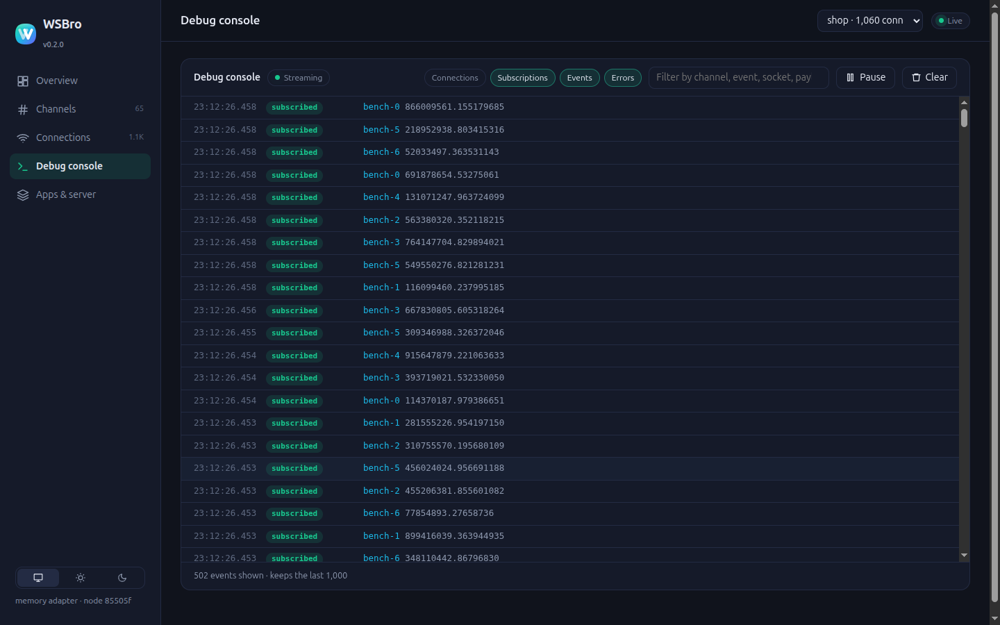

<p align="center">
  
</p>

<p align="center">
  <a href="https://github.com/axvilab/wsbro/actions/workflows/ci.yml"></a>
  <a href="https://github.com/axvilab/wsbro/actions/workflows/e2e.yml"></a>
  <a href="https://github.com/axvilab/wsbro/releases"></a>
  <a href="LICENSE"></a>
</p>

<p align="center">
  <b>Real-time for Laravel without Pusher bills or a PHP process to babysit.</b><br>
  One 20 MB binary that speaks the Pusher protocol. Point Laravel at it and broadcasting just works.
</p>

<p align="center">
  <a href="#quick-start">Quick start</a> ·
  <a href="docs/laravel.md">Laravel guide</a> ·
  <a href="#dashboard">Dashboard</a> ·
  <a href="docs/benchmarks.md">Benchmarks</a> ·
  <a href="#documentation">Docs</a>
</p>

---

## Why WSBro

- **Drop-in for Reverb and Pusher.** Laravel's own `reverb` and `pusher` broadcasters, Laravel Echo and
  every Pusher SDK work unchanged. No package to install, no code to change.
- **One binary, nothing else.** No PHP worker, no Node.js, no database. `docker run` and you are live.
- **Fast and frugal.** 100,000 concurrent connections in 3.3 GB of RAM; 160,000 messages per second
  with a p99 latency of 3 ms on one instance. [Benchmarks](docs/benchmarks.md)
- **A dashboard you will actually use.** Live debug console, presence members, test events,
  connections you can disconnect. Built in, works offline.
- **Proven, not promised.** Every change runs a real Laravel 12 and 13 app with laravel-echo and
  pusher-js through WSBro, on both broadcasters.

## Quick start

```bash
docker run -d --name wsbro -p 6001:6001 \
  -e WSBRO_APP_ID=my-app \
  -e WSBRO_APP_KEY=my-key \
  -e WSBRO_APP_SECRET=my-secret \
  -e WSBRO_DASHBOARD_PASSWORD=change-me \
  ghcr.io/axvilab/wsbro
```

Or without Docker: download a binary from [Releases](https://github.com/axvilab/wsbro/releases), or
`go install github.com/axvilab/wsbro@latest`.

The dashboard is at <http://localhost:6001/dashboard>.

## Use it with Laravel

Already on Reverb? Keep your code and your `.env`, just stop running `php artisan reverb:start` and point
`REVERB_HOST` / `REVERB_PORT` at WSBro:

```env
BROADCAST_CONNECTION=reverb

REVERB_APP_ID=my-app
REVERB_APP_KEY=my-key
REVERB_APP_SECRET=my-secret
REVERB_HOST=127.0.0.1
REVERB_PORT=6001
REVERB_SCHEME=http
```

Everything works as with Reverb or Pusher:

```php
broadcast(new OrderShipped($order))->toOthers();
```

```js
Echo.private(`App.Models.User.${userId}`).listen('.order.shipped', (e) => { /* ... */ });

Echo.join('chat')
    .here((users) => {})
    .joining((user) => {})
    .leaving((user) => {})
    .listenForWhisper('typing', (e) => {});
```

Prefer the Pusher broadcaster, or setting up from scratch? See the [Laravel guide](docs/laravel.md).

## Features

| | |
|---|---|
| **Pusher protocol 7** | public, private, presence, encrypted and cache channels; client events (whisper); user authentication, `sendToUser` and terminate connections |
| **Pusher HTTP API** | trigger, batch, channel info and presence users, signed exactly like Pusher (replay-safe `body_md5` check) |
| **Webhooks** | `channel_occupied`, `channel_vacated`, `member_added`, `member_removed` in the Pusher format, verifiable with the official SDKs |
| **Multi-app** | many apps on one server, fully isolated, each with its own limits, allowed origins and webhook |
| **Protection** | connection, message rate, channel and payload limits; allowed origins; slow and dead clients dropped without affecting others |
| **Scaling** | Redis or NATS to run several instances; graceful shutdown hands clients over |
| **Observability** | dashboard with a live debug console, JSON and Prometheus metrics, JSON logs, health endpoint |
| **Operations** | TLS, 20 MB multi-arch image running as non-root, systemd-friendly binary, strict configuration validation |

## Dashboard

<p align="center">
  
</p>

<table>
  <tr>
    <td width="50%"></td>
    <td width="50%"></td>
  </tr>
  <tr>
    <td align="center">Presence members, live activity and test events per channel</td>
    <td align="center">Debug console: every connection, subscription and event, live</td>
  </tr>
</table>

Enable it with `WSBRO_DASHBOARD_PASSWORD`. [More about the dashboard](docs/dashboard.md).

## How it compares

| | **WSBro** | Laravel Reverb | Soketi | Sockudo |
|---|---|---|---|---|
| Runs as | single Go binary | PHP process (`artisan reverb:start`) | Node.js | single Rust binary |
| Pusher protocol | ✅ | ✅ | ✅ | ✅ |
| Works with Laravel's `reverb` broadcaster | ✅ | ✅ | ✅ | ✅ |
| Dashboard | built in, with live debug console | via Laravel Pulse cards | — | separate service |
| Scaling | Redis, NATS | Redis | Redis, NATS, cluster | many brokers |
| Focus | small, simple, Laravel-first | Laravel's official solution | general purpose | feature-rich platform |

All of them are good projects. WSBro is for teams that want Reverb's compatibility without running PHP
for WebSockets, and the smallest possible thing to deploy and understand.

## Documentation

| | |
|---|---|
| [Laravel](docs/laravel.md) | Reverb drop-in, Pusher broadcaster, webhooks, troubleshooting |
| [Configuration](docs/configuration.md) | every environment variable, multiple apps |
| [Channels](docs/channels.md) | channel types, presence, client events, cache and user channels |
| [Deployment](docs/deployment.md) | Docker, systemd, Nginx and Caddy with TLS, monitoring, production checklist |
| [Scaling](docs/scaling.md) | one big instance, Redis and NATS, what is shared between instances |
| [Webhooks](docs/webhooks.md) | events, format and signature verification |
| [Dashboard](docs/dashboard.md) | pages and security |
| [API](docs/api.md) | HTTP API, WebSocket protocol, error codes |
| [Benchmarks](docs/benchmarks.md) | numbers and how to reproduce them |

## Roadmap

- Shared presence state across instances (exact `here()` lists and channel counts with Redis)
- Ready-made Helm chart
- Webhook retries with back-off
- Subscription count events (`pusher:subscription_count`)

Ideas and pull requests are welcome, see [CONTRIBUTING.md](CONTRIBUTING.md).

## From the author

Curious about Rust? I wrote two books for Laravel developers:
[Rust for Laravel Developers](https://leanpub.com/rust-for-laravel-developers) and
[Loco for Laravel Developers](https://leanpub.com/loco-for-laravel-developers).
More tools and posts on [axvi.dev](https://axvi.dev).

## License

[MIT](LICENSE) © AxViLab
